<p align="center">
  
</p>

<p align="center">
  <a href="mailto:prexcaangay@gmail.com"></a>
  <a href="https://www.instagram.com/prxcyng/"></a>
  <a href="https://www.threads.com/@prxcyng"></a>
</p>

```text
.:-=+*#%@  HYUN ─────────────────────────────────────────────── ● online

  role      software engineer
  builds    the pulse ecosystem · small, quiet, monochrome tools
  stack     rust · swift · c# · python · typescript · react · tauri
  rule      local-first. no telemetry. it should idle at a few percent cpu.
```

### ▌ the pulse ecosystem

Five tools for your desktop, your servers, your team and your network. One quiet look.

<table>
  <tr>
    <td width="50%"><a href="https://github.com/itsnothyun/Pulse"></a></td>
    <td width="50%"><a href="https://github.com/itsnothyun/Pulse-Explorer"></a></td>
  </tr>
  <tr>
    <td></td>
    <td></td>
  </tr>
  <tr>
    <td colspan="2" align="center"></td>
  </tr>
</table>

### ▌ also building

<table>
  <tr>
    <td width="50%"><a href="https://github.com/itsnothyun/Stash"></a></td>
    <td width="50%">
      <b><a href="https://github.com/itsnothyun/Stash">Stash</a></b><br>
      Floating sticky notes with a real workspace behind them. Press <code>Ctrl/Cmd + Shift + N</code> anywhere,
      write, and find it again with full-text search. SQLite on your machine, no cloud.<br><br>
      <a href="https://github.com/itsnothyun/Stash/releases/latest">Download</a> ·
      <a href="https://stash-gray.vercel.app">Website</a>
    </td>
  </tr>
</table>

### ▌ pulse of the day

<!-- pulse:start -->
```text
 RECENT ──────────────────────────────────────────────────────
  2026-11-24  Stash            quiet this week
  2026-11-24  Pulse-Explorer   1 commit this week
  2026-11-19  Pulse            quiet this week

 RELEASES ────────────────────────────────────────────────────
  Pulse            v1.2.0    2026-10-19
  Stash            v0.1.3    2026-10-15

  last beat  2026-11-24 04:48 UTC  ·  field phase 328
```
<!-- pulse:end -->

<p align="center">
  
</p>
