<!-- pulse:start -->

  

<!-- pulse:end -->

  
  &nbsp;
  
  &nbsp;
  

  
    <a href="https://github.com/itsnothyun/Pulse">pulse</a> &nbsp;·&nbsp;
    <a href="https://github.com/itsnothyun/Pulse-Explorer">explorer</a> &nbsp;·&nbsp;
    <a href="https://github.com/itsnothyun/Stash">stash</a>
  

