  

  
  &nbsp;
  
  &nbsp;
  

  

### ▌ the pulse ecosystem

Five tools for your desktop, your servers, your team and your network. One quiet look.

<table>
  <tr>
    <td width="50%"></td>
    <td width="50%"></td>
  </tr>
  <tr>
    <td></td>
    <td></td>
  </tr>
  <tr>
    <td colspan="2" align="center"></td>
  </tr>
</table>

### ▌ also building

<table>
  <tr>
    <td width="50%"></td>
    <td width="50%">
      <b><a href="https://github.com/itsnothyun/Stash">Stash</a></b> 
      Floating sticky notes with a real workspace behind them. Press <code>Ctrl/Cmd + Shift + N</code> anywhere,
      write, and find it again with full-text search. SQLite on your machine, no cloud.  
      <a href="https://github.com/itsnothyun/Stash/releases/latest">Download</a> ·
      <a href="https://stash-gray.vercel.app">Website</a>
    </td>
  </tr>
</table>

### ▌ pulse of the day

<!-- pulse:start -->

  

<!-- pulse:end -->

